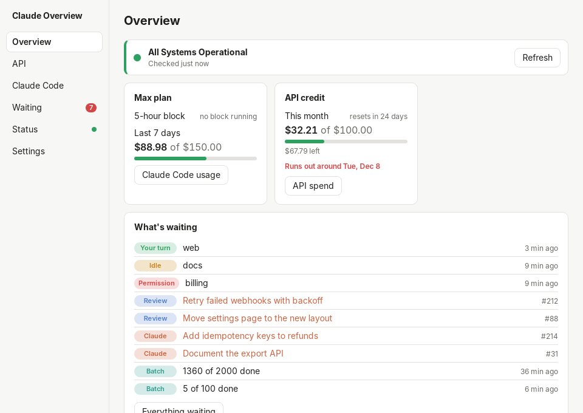
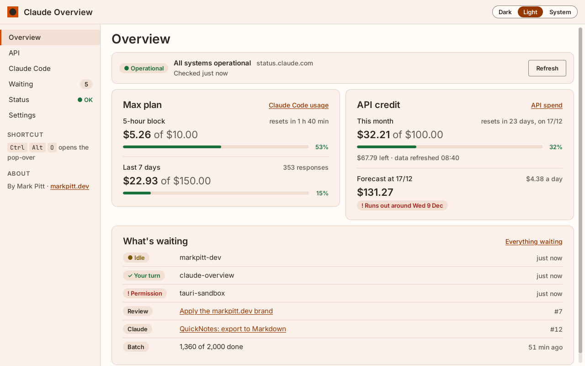
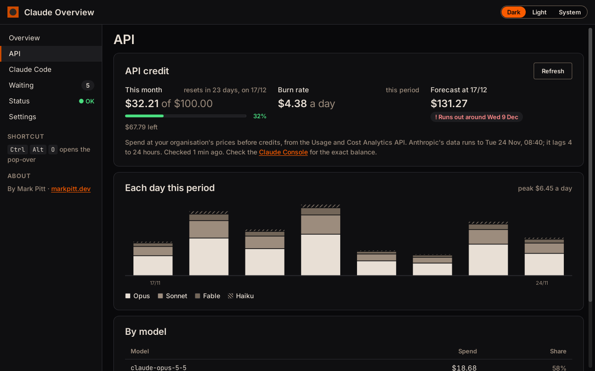
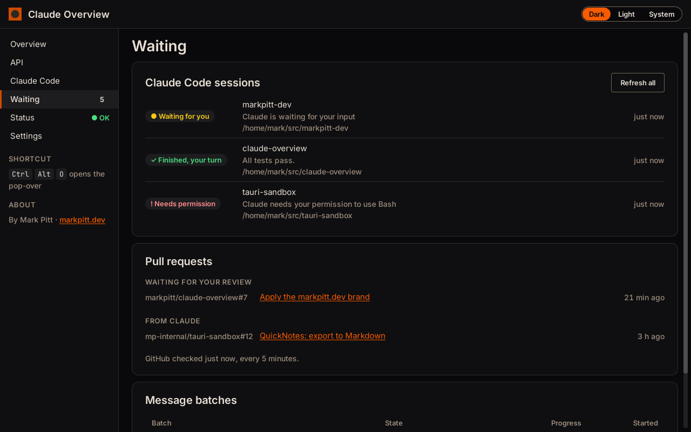
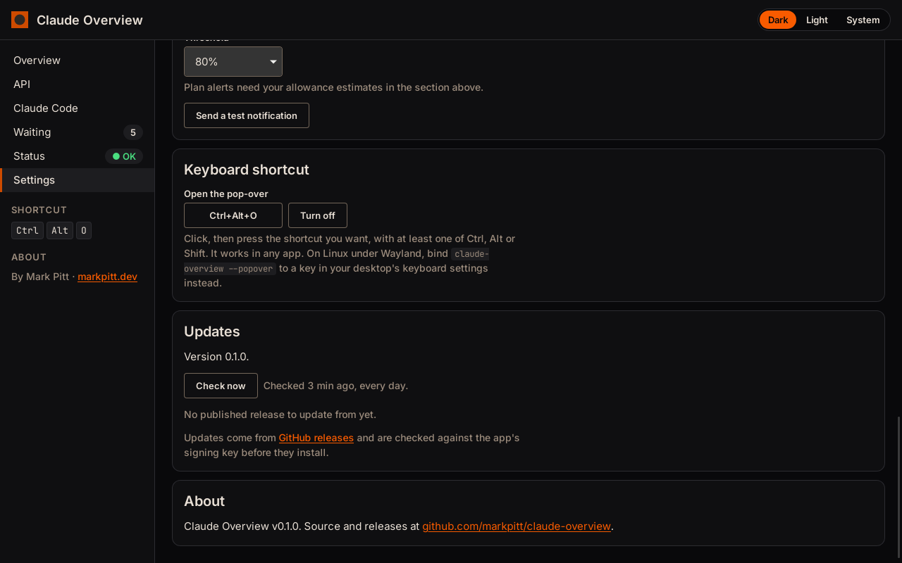
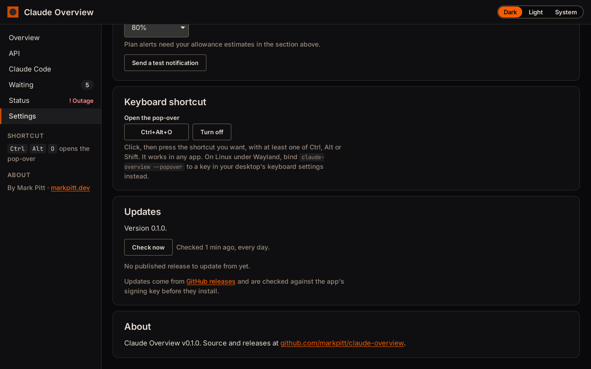

<h1>
  <picture>
    <source media="(prefers-color-scheme: dark)" srcset="docs/assets/banner-dark.svg">
    
  </picture>
</h1>

Claude Overview is a tray app for Windows, Linux and macOS that puts Claude's service status, Max plan usage, API credit and the work waiting for you in one place.

I built it because I use Claude Code and the Claude API every day, and checking all of this meant three websites and a terminal. It shows:

- **Service status** from status.claude.com
- **Max plan usage** from local Claude Code logs, with the 5-hour block countdown
- **API credit** spend against the monthly allowance, with a forecast
- **What's waiting**: Claude Code sessions, batches in progress and pull requests to review
- **Alerts**, a **global shortcut** for the pop-over, and **signed updates** from GitHub releases

Early days: 0.1.2 is the current release. The Max plan figures are estimates against limits you set yourself, because Anthropic doesn't publish them.

Built with [Tauri 2](https://tauri.app), React and TypeScript. Rust owns every network call and key; the webviews only draw what Rust sends.





## Using it

- **Tray icon**: the markpitt.dev disc, with a dot in the corner for the worst current state: green, amber or red, grey when status can't be read. Hover for the word and the headline.
- **Theme**: Dark, Light or System (the default, which follows the OS) from the control at the top right of the main window. The choice is saved and applies to the pop-over too.
- **Pop-over**: click the tray icon (Windows, macOS) or choose *Show summary* from its menu.
- **Main window**: *Open Claude Overview* from the tray menu, or launch the app again.
- **Keyboard**: Ctrl+Alt+O (⌘⌥O on a Mac) opens and closes the pop-over from any app. Change or turn it off in Settings.
- **Linux**: tray icons send no click events, so the pop-over opens from the menu or the shortcut. Global shortcuts need X11; under Wayland, bind a desktop shortcut to `claude-overview --popover` instead. On GNOME, install the *AppIndicator and KStatusNotifierItem Support* extension or no tray icon shows; the main window still opens on launch.
- **Start at login**: Settings → *Start at login, in the tray*. The login entry passes `--hidden`, so nothing opens until you ask.

Closing the main window hides it. *Quit* is in the tray menu.

## Max plan usage

Claude Code writes a transcript for every session under `~/.claude/projects` (or `$CLAUDE_CONFIG_DIR/projects`). The app reads each new line as it is written, keeps the usage in a small SQLite database in the app data folder (90 days), and shows:

- the current **5-hour block**, what it has cost at API prices and when it resets;
- the **last 7 days** and **last 30 days** at API prices, the 30 days as a multiple of what you pay for the plan;
- a **30-day chart** by model family and a **table of projects**;
- a **log reader** panel with the folder, file and line counts and a *Rescan* button.

Anthropic does not publish Max plan limits, so the block window follows the convention community tools use (a block starts at the hour of your first message and lasts 5 hours) and the allowances are your own estimates, set in Settings. A good starting point: note what the block cost the last time you hit a limit. claude.ai chats are not in these logs, so they are not counted.

Costs use the API price list in `src-tauri/src/claude_code.rs`. A model missing from it is counted in tokens and listed under *No price for*.


## API credit

Add an Admin API key (`sk-ant-admin…`, from [Console settings, Admin keys](https://platform.claude.com/settings/admin-keys)) in Settings. The key goes into the OS keychain (Keychain on macOS, Credential Manager on Windows, the Secret Service on Linux, so GNOME Keyring or KWallet must be running) and is only ever sent to api.anthropic.com. It is never written to the database or shown again; Settings shows its last four characters.

Every 30 minutes the app reads this credit period's spend from the Usage and Cost Analytics API, grouped by model and day, and shows:

- spend against the monthly credit ($100 by default) and when it resets (the 17th by default, UTC);
- the average burn per day this period and the forecast at the reset date, with the date the credit runs out at that rate;
- spend per day and per model.

Anthropic's cost data lags 4 to 24 hours, so the figures run to the *data refreshed* time the API reports, which the panel shows. Amounts are before credits are applied; the Console shows the exact balance. The last good figures are kept in the local database, so the panel isn't empty while offline.



## What's waiting

The Waiting tab, the Overview card and the pop-over list what needs you, from three sources. Each is optional.

**Claude Code sessions.** Press *Add the hooks* on the Waiting tab (or in Settings). That adds `Notification`, `Stop` and `SessionEnd` hooks to `~/.claude/settings.json` (or `$CLAUDE_CONFIG_DIR/settings.json`), each running `claude-overview --hook`. A copy of the file is kept beside it as `settings.json.claude-overview.bak`, and your other settings and hooks are left alone. When Claude Code asks for permission, goes idle or finishes a turn, the hook writes a small marker file in the app's data folder; the session shows as waiting until you carry on in it (its transcript changes) or it ends. *Remove hooks* takes only these entries out again. If the app moves, add the hooks again so they point at the new path.

**Message Batches.** Add an ordinary API key (`sk-ant-api…`) in Settings. Every 5 minutes the app lists batches in that key's workspace and shows those running or ended in the last day, with progress.

**Pull requests.** Add a GitHub [fine-grained token](https://github.com/settings/personal-access-tokens/new) with read-only *Pull requests* access to the repositories you want watched. Every 5 minutes the app searches for open PRs waiting for your review, and your own open PRs that Claude Code opened (their description carries the Claude Code footer).

The API key and token go into the OS keychain like the Admin key. The tab shows a count of sessions and PRs waiting.



## Alerts

Desktop notifications, each of which can be turned off in Settings:

- a Claude incident starts, and when it is resolved;
- the 5-hour block or the last 7 days pass 80% of your allowance estimate (the threshold is adjustable);
- API spend passes 80% of the monthly credit;
- a pull request needs your review, or Claude opens one.

Each threshold alerts once, then re-arms when use drops below it again (a new block, week or credit period). What has been alerted is kept in the local database, so a restart doesn't repeat it. The first list of pull requests after adding a token is taken in silently. *Send a test notification* checks your OS lets them through.



## Updates

Once a day the app checks GitHub releases for a newer version. When there is one, it shows in Settings (and the tab gets an *Update* badge) with *Install and restart*. Packages are signed, and the app refuses one whose signature doesn't match the public key built into it. On Linux the update installs the same kind of package you have (.deb or AppImage); the .deb needs your password for `dpkg`.



## Releasing

1. Set the version everywhere: `node scripts/version.mjs 0.2.0`, then commit and merge.
2. Tag the merge and push the tag: `git tag v0.2.0 && git push origin v0.2.0`.
3. The *Release* workflow checks the tag matches the version, builds Linux (.deb, AppImage), Windows (NSIS installer) and macOS (universal .app, .dmg), signs the update files and attaches everything, with `latest.json`, to a **draft** release.
4. Review the draft on GitHub and publish it. Installed apps pick it up within a day.

The signing key is made once with `npx @tauri-apps/cli signer generate -w ~/.tauri/claude-overview.key` (the full package name, so it works outside the checkout) and lives in the repository secrets `TAURI_SIGNING_PRIVATE_KEY` (the key file's contents) and `TAURI_SIGNING_PRIVATE_KEY_PASSWORD`. Its public half is `plugins.updater.pubkey` in `src-tauri/tauri.conf.json`. Losing the private key means installed copies can't update; they would need a manual reinstall with a new key. Builds are unsigned at the OS level, so Windows SmartScreen and macOS Gatekeeper warn on first install.

## Developing

Prerequisites: Node 22, stable Rust, and on Linux the Tauri packages:

```bash
sudo apt-get install -y libwebkit2gtk-4.1-dev libayatana-appindicator3-dev librsvg2-dev libxdo-dev libssl-dev
```

```bash
npm ci
npm run tauri dev          # run with hot reload
npm run tauri build        # release build and installers
npm run typecheck && npm run lint && npm test
(cd src-tauri && cargo clippy --all-targets -- -D warnings && cargo test)
```

The Claude Code screenshots use synthetic transcripts (`CLAUDE_CONFIG_DIR` pointed at a demo folder), not real sessions.

`CLAUDE_OVERVIEW_API_BASE` points the credit poller at a test server; the API screenshots used a local mock with made-up spend.

`CLAUDE_OVERVIEW_GITHUB_BASE` points the PR search at a test server, and batches use `CLAUDE_OVERVIEW_API_BASE`. The waiting screenshots used the same mock with made-up batches and PRs, and markers written by piping hook JSON into `claude-overview --hook`.

`CLAUDE_OVERVIEW_UPDATE_URL` points the update check at another `latest.json`. Release builds only accept `https` there unless the build also takes `--config` with `plugins.updater.dangerousInsecureTransportProtocol` set, which is how the update was tested against a local server.

`CLAUDE_OVERVIEW_STATUS_BASE` points the status poller at another feed, which is how the degraded screenshots were made from `src-tauri/tests/fixtures/summary-degraded.json` (a synthetic outage).

Each main-window screenshot has a light twin beside it (`overview-light.png` and so on), taken under Xvfb in the same run. `tray-states.png` shows the tray icon for OK, degraded, outage and unknown, from the pixels `tray_icon.rs` draws.

## The website

The project's site, at [markpitt.dev/claude-overview](https://markpitt.dev/claude-overview/), is an Astro project in `site/`: a home page and the usage docs, in the markpitt.dev brand. It builds on its own:

```bash
cd site
npm ci
npm run dev                 # serve with hot reload
SITE_BASE=/ npm run build   # the base path is config; the default is /claude-overview/
npm test                    # Playwright smoke tests, both themes, desktop and phone
```

`site/src/chrome/` holds the shared markpitt.dev header, sub-bar, footer, tokens and fonts. `.github/workflows/pages.yml` builds and tests the site on pull requests and deploys it to GitHub Pages from `main`.

## Layout

| Path | What |
| --- | --- |
| `src-tauri/src/status.rs` | Status feed fetch and parsing, with fixture tests |
| `src-tauri/src/claude_code.rs` | Transcript line parser, price table, 5-hour blocks |
| `src-tauri/src/store.rs` | SQLite cache: usage, read positions, settings |
| `src-tauri/src/cc_service.rs`, `cc_task.rs` | Incremental scan, file watcher, summary for the UI |
| `src-tauri/src/api_credit.rs`, `api_task.rs` | Cost API fetch, credit period, burn rate and forecast; 30-minute poller |
| `src-tauri/src/hooks.rs` | Claude Code hooks: `--hook` mode, marker files, adding and removing settings entries |
| `src-tauri/src/batches.rs`, `github.rs` | Message Batches list; GitHub PR search |
| `src-tauri/src/waiting_task.rs` | Marker watcher and 5-minute poller for what's waiting |
| `src-tauri/src/alerts.rs` | Alert rules and their memory; desktop notifications |
| `src-tauri/src/hotkey.rs` | Global shortcut for the pop-over |
| `src-tauri/src/updater.rs` | Daily update check, download and install |
| `src-tauri/src/keys.rs` | API keys and the GitHub token in the OS keychain |
| `src-tauri/src/tray_icon.rs` | Tray icons drawn at runtime: the disc with a status dot |
| `src-tauri/src/lib.rs` | Windows, tray, poller, commands |
| `src/` | React UI; `App.tsx` picks the pop-over or main window by window label |
| `src/styles.css` | The markpitt.dev brand tokens (dark and light) and every style; no colour outside the token block |
| `src/lib/theme.ts` | Dark, Light or System, saved and shared by both windows |
| `src/assets/fonts/` | Inter and JetBrains Mono as woff2 (SIL OFL), bundled so nothing is fetched |
| `docs/` | Plan and screenshots |
| `site/` | The project's website, an Astro site on GitHub Pages |
| `.github/workflows/ci.yml` | Typecheck, lint, tests, clippy, and builds for all three OSes |
| `.github/workflows/release.yml` | Draft release with signed installers and `latest.json`, on a `v*` tag |
| `scripts/version.mjs` | Sets or checks the version in package.json, tauri.conf.json and Cargo.toml |

See [docs/plan.md](docs/plan.md) for the full plan and decisions.

## Licence

MIT, see [LICENSE](LICENSE). The bundled Inter and JetBrains Mono fonts are under the SIL Open Font License.

The licence covers the code and docs. It doesn't cover the markpitt name or brand: the MARKPITT wordmark, the logo and the banners are © 2026 Mark Pitt, all rights reserved.
