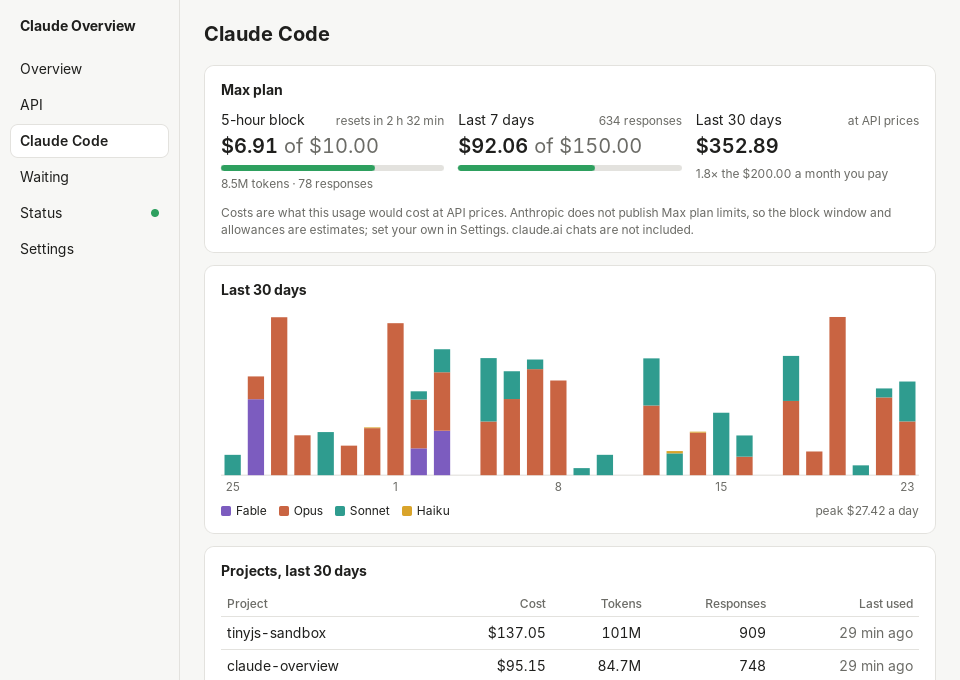

# Claude Overview

A small tray app for Windows, Linux and macOS that shows, in one place:

- **Service status** from status.claude.com *(milestone 1)*
- **Max plan usage** from local Claude Code logs, with the 5-hour block countdown *(milestone 2, this PR)*
- **API credit** spend against the monthly allowance, with a forecast *(milestone 3)*
- **What's waiting**: Claude Code sessions, batches in progress and PRs to review *(milestone 4)*

Built with [Tauri 2](https://tauri.app) and React + TypeScript. Rust owns every network call and key; the webviews only draw what Rust sends.


## Using it

- **Tray icon**: green, amber or red for the worst current state, grey when status can't be read. Hover for the headline.
- **Pop-over**: click the tray icon (Windows, macOS) or choose *Show summary* from its menu.
- **Main window**: *Open Claude Overview* from the tray menu, or launch the app again.
- **Linux**: tray icons send no click events, so the pop-over opens from the menu. Bind a desktop shortcut to `claude-overview --popover` to toggle it from the keyboard. On GNOME, install the *AppIndicator and KStatusNotifierItem Support* extension or no tray icon shows; the main window still opens on launch.
- **Start at login**: Settings → *Start at login, in the tray*. The login entry passes `--hidden`, so nothing opens until you ask.

Closing the main window hides it. *Quit* is in the tray menu.

## Max plan usage

Claude Code writes a transcript for every session under `~/.claude/projects` (or `$CLAUDE_CONFIG_DIR/projects`). The app reads each new line as it is written, keeps the usage in a small SQLite database in the app data folder (90 days), and shows:

- the current **5-hour block**, what it has cost at API prices and when it resets;
- the **last 7 days** and **last 30 days** at API prices, the 30 days as a multiple of what you pay for the plan;
- a **30-day chart** by model family and a **table of projects**;
- a **log reader** panel with the folder, file and line counts and a *Rescan* button.

Anthropic does not publish Max plan limits, so the block window follows the convention community tools use (a block starts at the hour of your first message and lasts 5 hours) and the allowances are your own estimates, set in Settings. A good starting point: note what the block cost the last time you hit a limit. claude.ai chats are not in these logs, so they are not counted.

Costs use the API price list in `src-tauri/src/claude_code.rs`. A model missing from it is counted in tokens and listed under *No price for*.



## Developing

Prerequisites: Node 22, stable Rust, and on Linux the Tauri packages:

```bash
sudo apt-get install -y libwebkit2gtk-4.1-dev libayatana-appindicator3-dev librsvg2-dev libxdo-dev libssl-dev
```

```bash
npm ci
npm run tauri dev          # run with hot reload
npm run tauri build        # release build and installers
npm run typecheck && npm run lint && npm test
(cd src-tauri && cargo clippy --all-targets -- -D warnings && cargo test)
```

The Claude Code screenshots use synthetic transcripts (`CLAUDE_CONFIG_DIR` pointed at a demo folder), not real sessions.

`CLAUDE_OVERVIEW_STATUS_BASE` points the status poller at another feed, which is how the degraded screenshots were made from `src-tauri/tests/fixtures/summary-degraded.json` (a synthetic outage).

## Layout

| Path | What |
| --- | --- |
| `src-tauri/src/status.rs` | Status feed fetch and parsing, with fixture tests |
| `src-tauri/src/claude_code.rs` | Transcript line parser, price table, 5-hour blocks |
| `src-tauri/src/store.rs` | SQLite cache: usage, read positions, settings |
| `src-tauri/src/cc_service.rs`, `cc_task.rs` | Incremental scan, file watcher, summary for the UI |
| `src-tauri/src/tray_icon.rs` | Status-coloured tray icons drawn at runtime |
| `src-tauri/src/lib.rs` | Windows, tray, poller, commands |
| `src/` | React UI; `App.tsx` picks the pop-over or main window by window label |
| `docs/` | Plan and screenshots |
| `.github/workflows/ci.yml` | Typecheck, lint, tests, clippy, and builds for all three OSes |

See [docs/plan.md](docs/plan.md) for the full plan and decisions.
